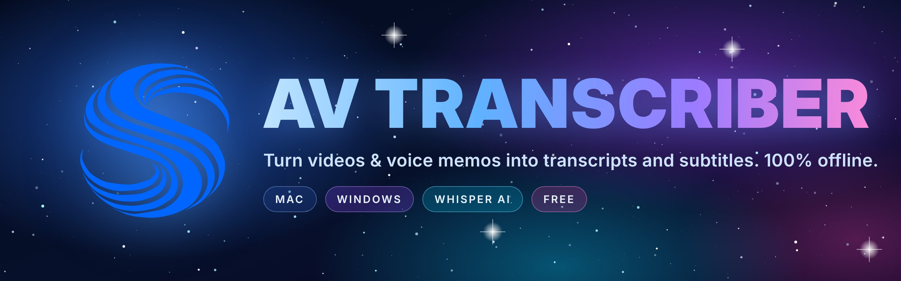
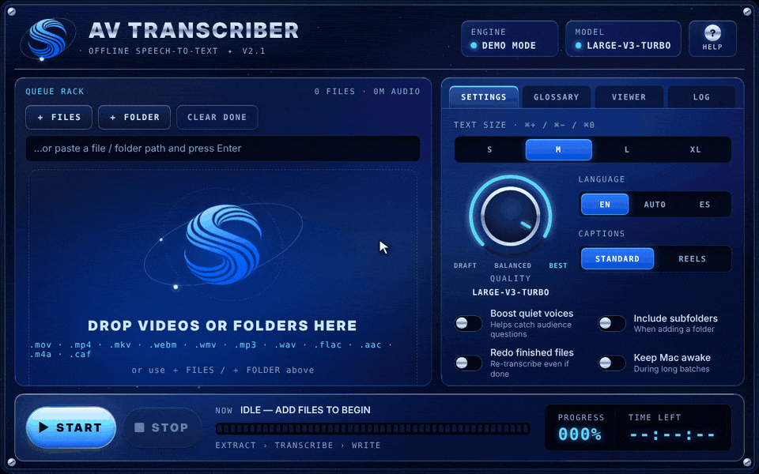
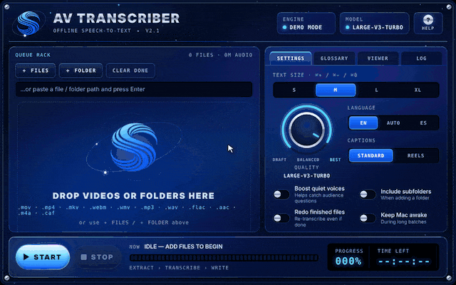
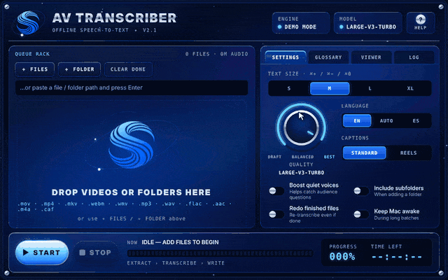
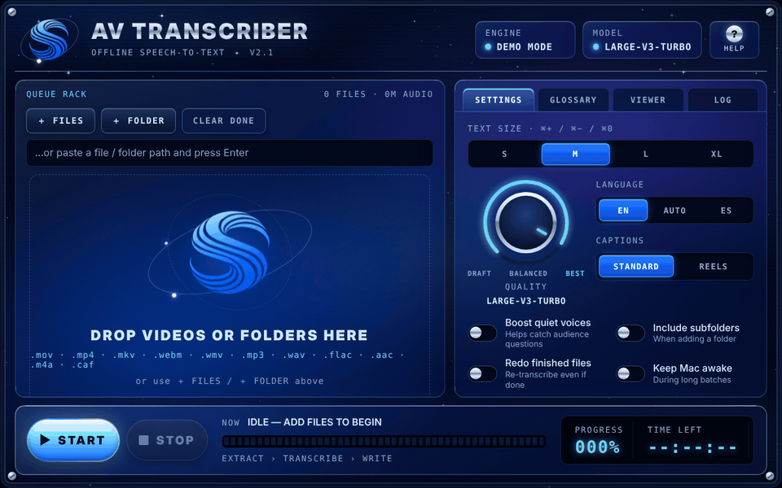
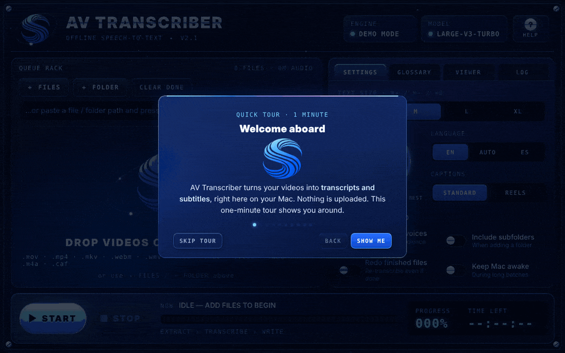
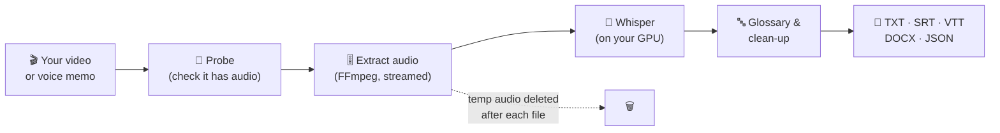

<p align="center">
  
</p>

<p align="center">
  <a href="#-install-on-a-mac"></a>
  <a href="#-install-on-windows"></a>
  <a href="#-faq"></a>
  <a href="#-what-it-reads-and-writes"></a>
  <br>
  
  
  
  
  <a href="LICENSE.md"></a>
</p>

<h3 align="center">Drop in a folder of videos. Get back transcripts and subtitles.<br>No uploads, no credits, no file-size limits.</h3>

<p align="center">
  <a href="https://github.com/DabRig/av-transcriber/archive/refs/heads/main.zip"><b>⬇️ Download</b></a> ·
  <a href="#-see-it-in-action">See it in action</a> ·
  <a href="#-install-on-a-mac">Install</a> ·
  <a href="#-faq">FAQ</a> ·
  <a href="docs/CHANGELOG.md">What's new</a>
</p>

<br>

<p align="center">
  
</p>

---

## ✨ Why AV Transcriber

|     |     |
| --- | --- |
| 🔒 **Everything stays on your computer** | Your recordings never leave your machine. Unplug the Wi-Fi and it still works. |
| 🎬 **Built for editors** | Subtitles drop straight into **Premiere Pro, CapCut and DaVinci Resolve**, plus a reels caption style for vertical video. |
| 🎙️ **Reads what you record** | Camera `.MOV`s, `.mp4`, `.mkv`, podcasts, and **Apple Voice Memos (`.caf`)**. |
| 📦 **Handles huge batches** | A 3 GB video uses about 50 MB of memory. Point it at a drive full of footage and walk away. |
| ⚡ **Fast on the GPU you have** | Apple-silicon Macs use the MLX engine; Windows PCs with an NVIDIA card use CUDA. |
| 🛟 **Never loses work** | Stop any time and START picks up where it left off. One broken file never stops the batch. |
| 🔤 **Spells your names right** | A glossary of people, brands and products, with automatic fixes for words it keeps mishearing. |
| 💸 **Free** | No accounts, no subscriptions, no per-minute fees. |

---

## 🎥 See it in action

<table>
<tr>
<td width="50%" valign="top">

### 🗂️ The queue rack
Drag in files or whole folders. Every row shows its length, a live progress bar
and a status light: **DONE**, **NO AUDIO** or **FAILED**, with the reason on hover.


</td>
<td width="50%" valign="top">

### ▶️ START & STOP
Watch each file go **EXTRACT › TRANSCRIBE › WRITE**, with the percentage and time
left. STOP finishes cleanly; START carries on from there.



</td>
</tr>
<tr>
<td width="50%" valign="top">

### 🎛️ Settings
Turn the **quality knob** from Draft to Best, pick the language and caption style,
and flip switches like *Boost quiet voices* and *Include subfolders*.



</td>
<td width="50%" valign="top">

### 🔠 Text size
Four sizes from **S** to **XL**, or ⌘/Ctrl + and −. The whole layout adapts,
even mid-batch.


</td>
</tr>
<tr>
<td width="50%" valign="top">

### 📖 Glossary
List the names Whisper should spell right. Write `wrong -> Right` to fix a word
it keeps mishearing.


</td>
<td width="50%" valign="top">

### 🔍 Viewer
Read any finished transcript with timestamps, search it, copy a line, or open the
TXT, SRT or Word file.



</td>
</tr>
<tr>
<td colspan="2" valign="top">

### ❓ Help Center & guided tour
A searchable manual is built in, with Mac or Windows instructions to match your
computer. A one-minute guided tour runs the first time you open the app.

<p align="center"></p>

</td>
</tr>
</table>

---

## 📼 What it reads and writes

**Reads**

| Kind | Formats |
| --- | --- |
| 🎬 Video | `.mov` `.mp4` `.mkv` `.webm` `.wmv` (upper-case `.MOV` from cameras and iPhones too) |
| 🎧 Audio | `.mp3` `.wav` `.flac` `.aac` `.m4a` |
| 🎙️ Voice Memos | `.caf` (Apple Core Audio, as saved by Voice Memos and other Apple apps) |

**Writes, for every file** (the full name is kept, so `talk.mov` and `talk.mp4` never overwrite each other):

| File | Use it for |
| --- | --- |
| `talk.mov.txt` | Reading: clean paragraphs, no timestamps |
| `talk.mov.timestamped.txt` | Finding moments: every line starts with `[HH:MM:SS]` |
| `talk.mov.srt` | **Subtitles for Premiere / CapCut / DaVinci**: ≤ 42 characters per line, ≤ 2 lines, ≤ 7 seconds each |
| `talk.mov.vtt` | Subtitles for web video players |
| `talk.mov.docx` | A Word document with a timestamp per paragraph (export to PDF from Word or Pages) |
| `talk.mov.json` | Full data with word-level timings. It also marks the file as finished. |

Transcripts are saved **next to each video** unless you pick another folder in SETTINGS.

---

## 🧭 How it works



1. **Probe:** every file is checked first. One with no audio is skipped, and a damaged one is marked FAILED while the batch carries on.
2. **Extract:** FFmpeg streams just the audio (about 115 MB per hour of video) into a temporary file. The video is never loaded into memory.
3. **Transcribe:** OpenAI's Whisper *large-v3-turbo* model runs on your own GPU.
4. **Clean up:** your glossary fixes names, and the lines Whisper sometimes invents over silence are filtered out.
5. **Write:** all outputs are written safely (never half-finished files), then the temporary audio is deleted.

---

## 🍎 Install on a Mac

> Best on an **Apple-silicon Mac (M1 or newer)**, which uses the fast MLX engine. Intel Macs work too, on the CPU (slower). Internet is needed for setup only. About 15 minutes.

1. **Download** the [ZIP](https://github.com/DabRig/av-transcriber/archive/refs/heads/main.zip), double-click it in Downloads, and move the unzipped folder into **Documents**.
2. **Open Terminal:** press ⌘ Space, type `Terminal`, press Enter.
3. Type `cd ` (with a space after it), **drag the project folder** from Finder into the Terminal window, and press Enter.
4. Type this and press Enter:

   ```
   bash setup_mac.command
   ```

   It installs Homebrew, **FFmpeg**, **Python 3.12**, the **MLX Whisper** engine and the **large-v3-turbo** model (about 1.6 GB), then builds **AV Transcriber.app**. If it asks for your Mac password, type it and press Enter (nothing appears while you type; that's normal).
5. Double-click **AV Transcriber.app** in the project folder and drag it to your Dock. The first time, macOS may ask to let it use files on an external drive: click **Allow**.

When setup finishes you'll see a checklist of ✓ marks. If one shows ✗, the line under it says how to fix it.

## 🪟 Install on Windows

> Needs **Windows 10 or 11 (64-bit)**. An **NVIDIA** graphics card makes it much faster, but it also runs on the CPU. About 15–20 minutes.

1. **Download** the [ZIP](https://github.com/DabRig/av-transcriber/archive/refs/heads/main.zip).
2. **Unblock it:** right-click the ZIP › **Properties** › tick **Unblock** › **OK**.
3. **Extract** it and rename the folder to **AV Transcriber**. Put it in your user folder (`C:\Users\you\AV Transcriber`), **not inside OneDrive**: OneDrive would try to upload the app's ~3 GB of engine files.
4. **Double-click `setup_windows.bat`.** It installs FFmpeg and Python 3.12 with winget (Windows' own installer), detects your NVIDIA card, downloads the speech model once, and adds **AV Transcriber** to the Desktop and Start menu. If Windows says *"Windows protected your PC"*, click **More info › Run anyway**.
5. Open **AV Transcriber** from the Start menu and pin it to the taskbar.

The header's ENGINE light should say **CUDA · NVIDIA GPU**. If it says **CPU**, update your NVIDIA driver (528 or newer), restart, and run `setup_windows.bat` again.

## 🔄 Updating

| | |
| --- | --- |
| 🍎 Mac | In Terminal: `cd ` + drag the project folder + Enter, then `bash update.command` |
| 🪟 Windows | Double-click **update_windows.bat** |

Updates keep your glossary, settings and transcripts.

---

## 🎞️ Into your editor

**Premiere Pro:** File › Import the `.srt`, then drag it onto the timeline above the clip. It becomes a captions track you can restyle.

**CapCut (desktop):** drag the `.srt` onto the timeline, or use **Captions › Import captions**. For vertical reels, choose the **Reels** caption style in SETTINGS for short one-line captions.

**DaVinci Resolve:** File › Import › Subtitle, then drag it onto the timeline.

> 💡 The captions start at 00:00:00, so line them up with the start of the clip.

---

## 🙋 FAQ

<details>
<summary><b>Is anything uploaded?</b></summary>

No. The internet is used only during setup, to install the tools and download the
model once. After that the app works fully offline and turns off the model
library's usage statistics.
</details>

<details>
<summary><b>How do I transcribe my iPhone Voice Memos?</b></summary>

On a Mac, open Voice Memos, select the recordings and drag them into AV Transcriber
(or onto a folder first). Voice Memos are saved as `.m4a` or `.caf`; both work.
</details>

<details>
<summary><b>How fast is it?</b></summary>

It depends on your computer. The first file shows the real speed: "12× real time"
means a 48-minute video takes about 4 minutes. Apple-silicon Macs and NVIDIA PCs
run several times faster than real time.
</details>

<details>
<summary><b>Does it label who is speaking?</b></summary>

Not yet. A new paragraph starts after a pause of 2+ seconds, which usually marks a
question or an answer.
</details>

<details>
<summary><b>Quiet audience questions are missing from the transcript.</b></summary>

Turn on **Boost quiet voices** in SETTINGS, tick **Redo finished files**, and run
those files again.
</details>

<details>
<summary><b>It can't write to my external drive.</b></summary>

The drive is probably formatted for Windows (NTFS), which a Mac can only read. Choose
a custom output folder in SETTINGS, or reformat the drive as exFAT so both Mac and
Windows can write to it.
</details>

<details>
<summary><b>A file shows FAILED.</b></summary>

Hover over the status to see why. The details are also in the LOG tab and in
`log.txt` next to the files. Every other file is unaffected.
</details>

<details>
<summary><b>Can I use it from the command line?</b></summary>

Yes. On a Mac run `./Transcribe.command "/path/to/folder"`; on Windows run
`Transcribe.bat "C:\path\to\folder"`. Add `--help` to see every option, such as
`--boost-quiet`, `--captions reels`, `--out`, `--recursive` and `--force`.
</details>

---

## 🛠️ For developers

```
transcribe.py            entry point (python transcribe.py --help)
avtool/gui/              the app: local API server, native window, HTML/CSS/JS
avtool/batch.py          the batch loop: probe, disk check, keep-awake, resume, log
avtool/media.py          scan, ffprobe, streamed ffmpeg audio extraction
avtool/backends.py       engine choice: mlx-whisper / faster-whisper / test engine
avtool/text.py           glossary, phantom-line clean-up, captions, paragraphs
avtool/writers.py        txt / timestamped / srt / vtt / docx / json, atomic writes
samples/make_samples.py  builds a test clip for every format
tests/                   python -m pytest -q
```

The tests run without downloading a model: a stand-in engine covers the whole
pipeline, and `tests/test_engine.py` runs the real faster-whisper engine with a
tiny model built locally. Set `AVTOOL_DEMO=1` to run the app with sample text
for screenshots. Design notes: [docs/DESIGN.md](docs/DESIGN.md). History:
[docs/CHANGELOG.md](docs/CHANGELOG.md).

---

## 💙 Credits

- [OpenAI Whisper](https://github.com/openai/whisper) (MIT): the speech model.
- [mlx-whisper](https://github.com/ml-explore/mlx-examples) (MIT) and [faster-whisper](https://github.com/SYSTRAN/faster-whisper) (MIT): the engines.
- [FFmpeg](https://ffmpeg.org): reads every media format.
- [pywebview](https://github.com/r0x0r/pywebview) (BSD): the native app window.
- [Inter](https://github.com/rsms/inter) typeface (SIL OFL 1.1), bundled for the app's lettering.
- [Buzz](https://github.com/chidiwilliams/buzz) (MIT) and [Vibe](https://github.com/thewh1teagle/vibe) (MIT) inspired the engine choice and the reels caption preset. Ideas only; no code was copied.

## 📜 License

Free for personal and other **non-commercial** use under the
[PolyForm Noncommercial License 1.0.0](LICENSE.md). The Sebastian Success logo and
app icon are © Sebastian Success, all rights reserved.

---

<p align="center">
  Made with 💙 by <b>Sebastian Success</b>
</p>

<p align="center">
  If AV Transcriber saved you some time, you can buy me a coffee ☕
</p>

<p align="center">
  <a href="https://buymeacoffee.com/sebastiansuccess"></a>
</p>
